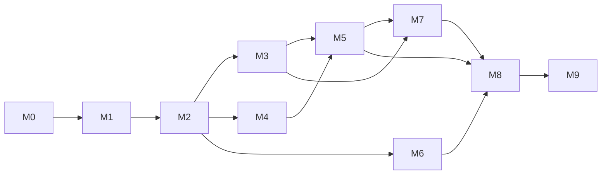

# genx — Roadmap to the first release

> Status: **accepted plan**, written 2026-11-13, revised by review 0002. genx is neozp's generation
> driver. Module: `github.com/epistemer/genx`.
>
> | Document | Answers |
> |----------|---------|
> | [ADR 0001](adr/0001-generation-pipeline.md) | *Why* a driver, and the convention it runs |
> | `interface.md` (written in M1.6) | *What* an app and a package author write |
> | this file | *In what order*, and *when each piece counts as done* |

## What gets built

One program. An app describes its generation in a manifest; packages describe
their generators in metafiles; the driver runs all of it.

```
producer             domain file                      trivial generator      output
cfgx gen ./schema →  zz_settings.labels.json      →   i18n: labels       →   internal/settings/zz_settings_i18n.go
sqlc generate     →  codegen_request.json         →   models: enums      →   models/zz_enums.labels.json
                     models/zz_enums.labels.json  →   i18n: labels       →   models/zz_models_i18n.go
```

The second and third rows are the backlog's first item: sqlc's file is
foreign, so a generator turns it into a labels file before i18n reads it.

Three commands:

| Command | Does |
|---------|------|
| `genx` | Runs the producers and the generators in order, writes what changed, deletes what nothing produces any more |
| `genx check` | Writes nothing. Fails if any output is stale, missing or left over |
| `genx list` | Shows the steps in order, what each reads and writes, and the generators in the module graph that aren't switched on |

Drafts of the two files, to make the plan concrete. Spike S3 tested them;
[interface.md](interface.md) replaces them (M1.6), with `use` naming
packages and without `vars`.

```yaml
# genx.yaml, at the app's module root: the manifest
version: 1

producers:
  - name: settings
    dir: internal/settings
    run:   [go, tool, cfgx, gen, ./schema]
    check: [go, tool, cfgx, gen, -check, ./schema]
    emits:
      - internal/settings/zz_settings.labels.json

  - name: models
    run: [go, tool, sqlc, generate, -f, config/sqlc.yaml]
    emits:
      - path: models/codegen_request.json
        domain: sqlc.request/v1      # a foreign file gets its domain here;
                                     # nothing below reads it yet

use:
  - github.com/epistemer/i18n: [labels]
```

```yaml
# the metafile in i18n's module
version: 1

generators:
  labels:
    doc: i18n keys for every label, one file per package
    needs: [labels/v1]
    # The input is always an object keyed by domain, each holding the
    # domain's files in path order (review 0002, finding 3).
    units: |
      .["labels/v1"] | group_by(.package.dir)[]
      | {package: .[0].package, labels: [.[].labels[]]}
    vars:
      package: .package
      labels: .labels
    out: '"\(.package.dir)/zz_\(.package.name)_i18n.go"'
    template: labels.go.tmpl
```

A generator that writes a domain file says so with `emits: [<domain>]`, so
the plan can order it before its readers without running it. Its output is
the JSON of a query's result, encoded by genx; a template never writes a
domain file. An app's own metafile is switched on under the app's own module
path in `use`.

## How to use this document

- **Ownership.** Claude owns genx until `v1.0.0`, on the terms of cfgx and
  i18n ([ownership.md](ownership.md), 2026-11-13).
- **IDs.** Every item has an ID (`M3.2`) and fits one PR or one focused
  session. Branch names, PR titles and commit subjects start with the ID.
- **Interface first.** M1 ends by freezing `docs/interface.md`. After that a
  change to what an app or a package author writes is an amendment, recorded
  there with its reason.
- **ADRs.** Each spike ends in an ADR. So does every new dependency.
- **Versions.** The first usable release is `v0.1.0`. `v1.0.0` waits until
  the sqlc generators (first in the backlog) run in a real app.
- **Sizes.** S is up to 1 day, M is 2–3 days, L is about 1 week, for one
  developer working without AI help. They order the work; they don't promise
  dates.

## Overview

| Milestone | Goal | Size (days) | Needs |
|-----------|------|-------------|-------|
| [M0](#m0--repository-foundation) | Repository, CI, test harness | ~5 | – |
| [M1](#m1--spikes-and-the-freeze) | Spikes S1–S5, then freeze the interface | ~13 | M0 |
| [M2](#m2--walking-skeleton) | One producer, one generator, one file, end to end | ~10 | M1 |
| [M3](#m3--trivial-generators) | Everything a metafile can say | ~10 | M2 |
| [M4](#m4--the-pipeline) | Several producers, ordered by the domains | ~8 | M2 |
| [M5](#m5--check-lock-and-cleanup) | `check`, the list of written files, stale output | ~10 | M3, M4 |
| [M6](#m6--finding-and-switching-on-generators) | Generators from other modules | ~7 | M2, S1 |
| [M7](#m7--labelsv1-and-test-helpers) | The labels domain, helpers for package authors | ~8 | M3, M5 |
| [M8](#m8--pilot-cfgx-and-i18n) | cfgx and i18n generate through the driver | ~4 here | M5, M6, M7 |
| [M9](#m9--hardening-and-v010) | Hardening, timings, **v0.1.0** | ~8 | M8 |

About 83 developer-days in the driver, plus cfgx's M11 (about 6) and i18n's
M6. cfgx's roadmap was about 140 days by the same measure.



M3, M4 and M6 touch different packages and can run in parallel after M2. M7
needs M5 only for M7.3 (`AssertGenerated` runs `check`).

## Definition of done (every work item)

1. Code and unit tests are written, and `go test -race ./...` passes on the
   whole CI matrix.
2. Behaviour a user can see is covered by a `testscript` case, including the
   exact text of each error.
3. Output is deterministic: a test runs the item twice and compares bytes.
4. If the behaviour differs from interface.md, that document is amended in
   the same PR.
5. A new dependency needs an ADR.
6. A new function for queries or templates needs an ADR. The default is none
   (ADR 0001 §7).

---

## M0 — Repository foundation

**Goal:** an empty repository where CI and the end-to-end harness already
work.

| ✓ | ID | Item | Size | Done when |
|---|----|------|------|-----------|
| ☐ | M0.1 | Module `github.com/epistemer/genx` with a `go 1.26` directive, MIT license, README stub, and the packages: `cmd/genx`, `internal/manifest`, `internal/meta`, `internal/query`, `internal/render`, `internal/plan`, `internal/run`, `genxtest` | S | `go build ./...` passes |
| ☐ | M0.2 | CI like cfgx's: Go {1.26, 1.27} × {linux, macOS, windows}; gofmt, `go vet`, staticcheck, `go test -race` | S | Green on all six jobs |
| ☐ | M0.3 | Test harness: a `testscript` runner that builds a temporary module, and a golden-file helper with `-update`. Copied from cfgx's `internal/e2e` and `internal/golden`, which can't be imported | S | A trivial script passes on all three OSes |
| ☑ | M0.4 | Docs: ADR 0001 moves in as `docs/adr/0001`; this file as `docs/roadmap.md`; an ADR template, `status.md` and `ownership.md` | S | Merged |
| ☑ | M0.5 | Cross-model review of ADR 0001 and this roadmap. Every finding becomes a change or a recorded rejection | S | Triage merged |

---

## M1 — Spikes and the freeze

**Goal:** remove the unknowns, then lock what people write. Each spike is
thrown away once its ADR is merged.

| ✓ | ID | Item | Size | Done when |
|---|----|------|------|-----------|
| ☑ | M1.1 | **S1: finding metafiles.** From an app, find another module's directory in module mode, with a `replace`, under `go.work`, with `-mod=vendor`, and from inside `go generate`. Try two placements: files in the module's root package directory, and files in a folder with no Go code. Also: a module required only as a `tool`, a module required but with no package imported yet (the app's first run), and lookups with the network off (`GOPROXY=off`). Time the lookup cold and warm | M | ADR with the timings, the placement rule, and what an app that vendors does. **Kill criterion:** if no placement works under vendoring without the network, the driver copies switched-on metafiles into the app with a `genx vendor` command, and the ADR says so |
| ☑ | M1.2 | **S2: gojq.** Run the query from i18n ADR 0003 and the `pascal` test on gojq. Compare with jq 1.7. Check that a query's `error` message comes through; that a query calling the clock, the environment or `input` can be refused by walking the parsed query; that `group_by` keeps the input order inside a group, which the order of merged labels depends on; time and memory on a 2 MB input; integers above 2^53 (decoding with `UseNumber`); the order of object keys, including `to_entries`, `keys_unsorted` and `.[]`, over 100 runs; that `$ENV`, `env`, `input`, `inputs`, `debug`, `stderr`, `import` and `include` are all refused, with gojq's environment and module loaders left unset; that a runaway query stops at a timeout through `RunWithContext` | M | ADR with the results and the list of refused functions. **Kill criterion:** if a query can't be made deterministic, can't be stopped, loses integer precision, or 2 MB takes more than 2 s or 500 MB, fall back to templates over the raw domain with a few functions (group, sort, unique), and re-plan M3 |
| ☑ | M1.3 | **S3: the labels pilot by hand.** Write the manifest and the metafile for cfgx's zp example in the draft format above, and run them with a throwaway driver of about 200 lines: labels file → i18n's generator → `zz_settings_i18n.go` | M | Same declarations as cfgx's file. Every field the drafts needed is in ADR 0001 §5, or the ADR is amended |
| ☑ | M1.4 | **S4: a foreign file.** In zp, get sqlc's request as JSON (its `json` output, or zp's own `gen/main` plugin, which writes the same file), name it as a domain in the manifest, and write `models/enums.go` and the enums' labels with trivial generators only | M | The enums file has the declarations of today's and zp builds with it. The ADR lists what naming done in a query couldn't match. **Kill criterion:** if the names can't be matched without sqlc's own rules, a foreign file needs a producer program, and the interface says so |
| ☑ | M1.5 | **S5: `check` for producers.** Try `cfgx gen -check`, `sqlc diff`, and one producer with no check mode of its own. Decide what the driver does for that last kind: run it in a temporary copy of the module and compare; or refuse. `check` never writes to the real tree, even for a moment | S | ADR |
| ☑ | M1.6 | **Freeze the interface.** `docs/interface.md`: the manifest, the metafile, domain files, `labels/v1` with a JSON Schema, the commands and their exit codes, who writes the generated-code header, and the file names. Also: the lock file's format, the rules for an output path, how genx finds the module root, what an empty render means, and how a non-Go output is recognized as generated | M | Locked by epistemer. cfgx M11.1 and i18n M6.1 can start |

**Exit:** five ADRs and a locked interface. The spikes' ADRs are 0003–0007;
0008 adds the YAML library.

---

## M2 — Walking skeleton

**Goal:** the thinnest path from a manifest to a written file.

| ✓ | ID | Item | Size | Done when |
|---|----|------|------|-----------|
| ☑ | M2.1 | `internal/manifest`: read and validate the manifest. Unknown fields are errors. Messages carry file and line | M | Table tests for every field and every error |
| ☑ | M2.2 | `internal/meta`: read and validate a metafile | S | Same |
| ☑ | M2.3 | `internal/query`: compile and run a jq query on decoded JSON; refuse the functions S2 lists; stop a query at a timeout | M | The refusals and the timeout have tests; a query's `error` reaches the caller with its message |
| ☑ | M2.4 | `internal/render`: `text/template` that fails on a missing field, then gofmt for `.go` output. Templates are read with CRLF turned into LF. An empty render behaves as M1.6 decided | S | A missing field and a syntax error in generated Go each give a message with the template's name and line |
| ☑ | M2.5 | `cmd/genx`: run producers in manifest order, then generators; write a file only when its bytes changed, through a temporary file and a rename | M | e2e: a temporary module with a script as producer and a local metafile gets the expected Go file; a second run changes nothing |

---

## M3 — Trivial generators

| ✓ | ID | Item | Size | Done when |
|---|----|------|------|-----------|
| ☑ | M3.1 | Inputs: every file of each needed domain, ordered by path, in an object keyed by domain, whether a generator needs one domain or several. JSON and YAML | M | e2e with two files of one domain and with two domains |
| ☑ | M3.2 | `units`, `vars` and `out`: each output of the units query is one render; vars are evaluated per unit. An `out` path must follow M1.6's rules on every OS (slash-separated, relative, no `..`, no `\`, `:` or reserved Windows names), stay out of dot-directories, `go.mod`, `go.sum`, `go.work`, the manifest and the lock, and belong to one generator only, compared without case. Every unit renders before anything is written. Writes and deletes go through `os.Root`, so a symlink can't lead outside the module | M | An e2e script for each refusal, naming the generator and the path; one with a symlink |
| ☑ | M3.3 | A generator that writes a domain file, for turning a foreign file into a domain. It declares `emits`, and genx encodes its query's result as JSON | S | e2e: foreign file → domain file → second generator → Go, in `use` order until M4.1 orders it |
| ☑ | M3.4 | Failures: a query's `error` names the generator, its module and the input files; template errors give file and line; a gofmt failure shows the generated lines around it | M | Golden files for each message |
| ☑ | M3.5 | Definitions shared by a metafile's queries (`defs`) | S | The `pascal` function is defined once and used by two generators |
| ☑ | M3.6 | Determinism: the same inputs give the same bytes on all three OSes | S | The e2e suite runs every script twice and compares; the golden outputs are the same files on all three OSes in CI |

---

## M4 — The pipeline

| ✓ | ID | Item | Size | Done when |
|---|----|------|------|-----------|
| ☑ | M4.1 | `internal/plan`: build the graph from what each step emits and needs, generators included (their `emits`); order it, with manifest order breaking ties. Errors: a needed domain nobody writes, a cycle, two steps writing one file | M | Unit tests for each error; the order is stable; e2e: sqlc-like foreign file → generator → labels → i18n's generator, declared in reverse order |
| ☑ | M4.2 | Producers: run argv without a shell, in `dir`, with a timeout, their output prefixed with the step's name. Afterwards each declared file must exist, parse, and say the declared domain | M | e2e for a failing producer, a missing file and a wrong domain |
| ☑ | M4.3 | Foreign files: a domain given in the manifest for a file that doesn't name one | S | e2e |
| ☑ | M4.4 | A producer may declare `needs`, so a program can read domain files and still run in order | S | e2e: a script that consumes a labels file runs after its producer |
| ☑ | M4.5 | `genx list`: the steps in order, with what each reads and writes | S | Golden output for the pilot's manifest |

---

## M5 — Check, lock and cleanup

| ✓ | ID | Item | Size | Done when |
|---|----|------|------|-----------|
| ☑ | M5.1 | The lock: the list of files the driver wrote, per step. Sorted; no hashes, no times | S | Two runs give the same lock |
| ☑ | M5.2 | Stale output: a file in the previous lock that this run doesn't produce is deleted if it still looks generated; otherwise the run fails and names it. No output ever replaces an existing file that isn't in the lock | M | e2e: dropping a generator from the manifest removes its file; a hand-edited one is kept and reported |
| ☑ | M5.3 | `genx check`: writes nothing. Producers are checked as S5 decided. Generators render in memory, over an overlay of what earlier generators rendered, and compare. Fails on stale, missing and leftover files, and lists them | L | e2e: each kind of staleness fails `check`, and the tree is unchanged afterwards (compared by hash) |
| ☑ | M5.4 | The generated-code header, as M1.6 decided, and the test for "still looks generated" | S | Covered by M5.2's scripts |
| ☑ | M5.5 | `go generate`: document `//go:generate go tool genx` in a file at the module root. `go generate` lists a package's files before it runs, so deleting one in the directive's own package fails | S | An e2e script under `go generate`; the README says where to put the directive |

---

## M6 — Finding and switching on generators

| ✓ | ID | Item | Size | Done when |
|---|----|------|------|-----------|
| ☑ | M6.1 | Resolve each `use` entry to a module directory, as S1 decided: module mode, `replace`, `go.work` | M | e2e in each mode |
| ☑ | M6.2 | Vendoring, as S1 decided | M | e2e with `-mod=vendor` and no network |
| ☑ | M6.3 | `genx list` also shows generators found in the module graph that the manifest doesn't use, with their module versions | S | Golden output |
| ☑ | M6.4 | Versions: a metafile's `version`, and the major version of each domain. A mismatch names the module to upgrade | S | e2e: a `labels/v2` file against a generator that needs `v1` |

---

## M7 — `labels/v1` and test helpers

| ✓ | ID | Item | Size | Done when |
|---|----|------|------|-----------|
| ☑ | M7.1 | `labels/v1`: the published JSON Schema, and the driver's own checks on a labels file: required fields, `var` is a Go identifier, `dir` is inside the module | M | Each rule has a failing example |
| ☑ | M7.2 | Conformance files: valid and invalid labels files that a producer copies into its tests. cfgx M11.1 uses them | S | Published under `testdata/labels/` |
| ☑ | M7.3 | `genxtest.AssertGenerated(t)` runs `check` from a test. `genxtest.Render` runs one generator on given domain files without a manifest, for golden tests in the generator's own module. i18n M6.1 uses it | M | Both are used by this repository's own example |
| ☑ | M7.4 | Two guides: writing a producer, and writing a trivial generator | M | Each guide's example runs in CI |

---

## M8 — Pilot: cfgx and i18n

**Goal:** the two existing packages generate through the driver, and the
labels file's Go comes out as before.

| ✓ | ID | Item | Size | Done when |
|---|----|------|------|-----------|
| ☑ | M8.1 | Tag `v0.1.0-rc.1` (cut as `v0.1.0-rc.2`: rc.1 couldn't be fetched) | S | `go get` resolves it through the module proxy |
| ☑ | M8.2 | In i18n: M6.1 and M6.2 against the release candidate | – | i18n's CI is green |
| ☑ | M8.3 | In cfgx: M11.2. `examples/zp` generates through the driver | – | The same declarations as before, compared in a test; cfgx's CI is green on three OSes |
| ☑ | M8.4 | A friction log from M8.2 and M8.3. Each entry becomes an amendment or a backlog item | M | Merged |

---

## M9 — Hardening and v0.1.0

| ✓ | ID | Item | Size | Done when |
|---|----|------|------|-----------|
| ✓ | M9.1 | Every failure path has an e2e script, and each message says what to do next | M | A checklist of failures, each linked to its script: [failures.md](failures.md) |
| ✓ | M9.2 | Timings: a cold and a warm run for cfgx's zp example, and one generator over zp's sqlc request | S | The numbers are in the README as measured |
| ✓ | M9.3 | Review of `genxtest` and of both file formats against the interface | S | Checklist merged: [review 0009](reviews/0009-gemini-m9.3-review.md) |
| ✓ | M9.4 | README quickstart: add the driver to an app that uses cfgx and i18n | M | A newcomer can follow it with no other help |
| ✓ | M9.5 | CHANGELOG, then tag `v0.1.0` | S | Tag pushed; i18n `v0.2.0` and cfgx `v0.2.0` follow |

---

## Order across the three repositories

| Step | Driver | cfgx | i18n |
|------|--------|------|------|
| 1 | M0, M1: spikes, then the freeze | – | – |
| 2 | M2–M7 | M11.1: `App.Labels()` and the labels file | – |
| 3 | M8.1: release candidate | – | M6.1, M6.2: the generator and its checks |
| 4 | M8.4: friction log | M11.2: `examples/zp` through the driver | M6.3: `examples/basic` through the driver |
| 5 | M9: `v0.1.0` | M11.3: `v0.2.0` | M6.4: `v0.2.0` |

Each package's example needs the other package. Pseudo-versions break the
tie: i18n's example pins cfgx at a commit after M11.1, i18n tags `v0.2.0`,
cfgx's example then requires it, and cfgx tags `v0.2.0`. No cfgx tag is cut
between M11.1 and M11.2.

## After v0.1.0 (ordered backlog)

1. ~~**neozp's models package on sqlc**~~: done. models `v0.1.0`
   (2026-11-14) runs on genx `v0.2.0`'s parameters (A4); its spike and
   its zp check matched all 995 of zp's keys. `v1.0.0` still waits for it
   to run in a real app (zp's move).
2. **Producer descriptions shipped by modules**, so the manifest names a
   producer and doesn't spell out its command.
3. **A kit for writing producers in Go**: cfgx's schema loader and golden
   helpers, extracted when the second Go producer (routes or errors) needs
   them.
4. **`meta` for labels**, with the routes generator.
5. **`genx init`**: a starter manifest from what the app's `go.mod` requires.
6. **`genx explain <file>`**: which step wrote a file, from which inputs.
7. **More shared domains** (routes, permissions), each when it has two
   producers or two consumers.
8. **Parallel steps**, and skipping steps whose inputs didn't change, only if
   M9.2's timings ask for it.

**Parking lot:** a watch mode; formatting for output that isn't Go; editor
schemas for the manifest and metafile.

## Risks

| Risk | Likelihood / impact | Mitigation |
|------|---------------------|------------|
| Queries and templates grow into a second programming language | High / medium | No custom functions by default; each one needs an ADR (definition of done, 6); ADR 0001 §7 sends real logic to a producer |
| The formats are frozen with one user | Medium / high | S4 runs a second, foreign user before the freeze; `v1.0.0` waits for the sqlc generators in a real app |
| Metafiles can't be found when an app vendors its dependencies | Medium / medium | S1 and its kill criterion |
| gojq differs from jq where it matters | Low / medium | S2; the interface says "jq as gojq implements it" and pins the version |
| A domain file changes under its consumers | Medium / high | Major versions; the published schema and conformance files; the driver refuses a major it doesn't know |
| `check` can't verify a producer that has no check of its own | Medium / medium | S5 |
| Three repositories must release in order | Medium / low | The table above; a release candidate; `App.I18n()` stays in cfgx until the switch |
| A dependency's generator writes where it shouldn't | Low / high | Nothing runs unless the manifest names it; output stays inside the module (through `os.Root`), out of dot-directories and module files, and never replaces a file the driver didn't write; a generator can't run code; `check` in CI shows a new output as a leftover-or-missing file in review |
| The driver turns into a build system | High / medium | Parallelism, caching and watching are backlog items that need a measured reason |
| Paths behave differently on Windows and on case-insensitive file systems | Medium / medium | One set of path rules on every OS, collisions compared without case (M3.2); CI on three OSes |
| The prototype ran on the C jq, with an input file a script made from cfgx's output | Low / medium | S2 and S3 repeat it on gojq with files a real producer writes |

## Decisions waiting on you

1. ~~Ownership~~: decided on 2026-11-13, Claude owns genx until `v1.0.0`.
2. **The two PRs** with the design records, in cfgx and i18n.
3. **Committing domain files.** ADR 0001 says yes: they're what `check`
   compares, and they show up in review.
4. **The freeze at M1.6.** Locking the interface is yours, as it was for cfgx
   and i18n.
